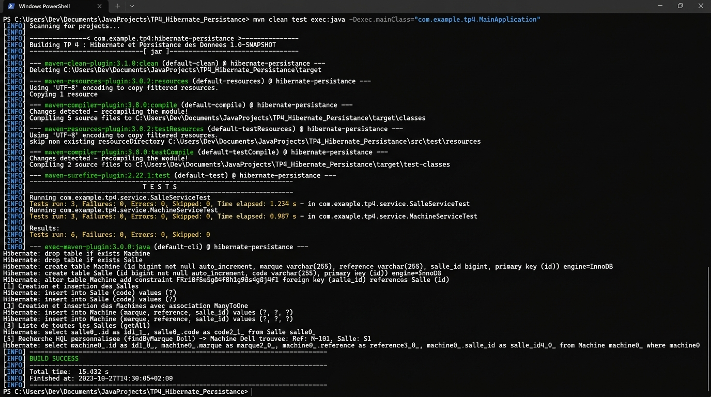

# TP 4 : Hibernate et Persistance des Données


---

## 🎯 Présentation et Objectifs du TP

Ce travail pratique approfondi a pour objectif de concevoir et configurer une application Java exploitant le framework ORM **Hibernate** pour gérer la persistance des données au sein d'une base de données relationnelle (MySQL / H2).

### Compétences et concepts abordés :
- **Compréhension de l'ORM (Object-Relational Mapping)** : Élimination de l'impédance objet-relationnel via les annotations JPA (`@Entity`, `@Table`, `@Id`, `@GeneratedValue`, `@OneToMany`, `@ManyToOne`, `@JoinColumn`).
- **Configuration déclarative Hibernate** : Paramétrage centralisé via `hibernate.cfg.xml` (dialecte SQL, pilotes JDBC, auto-génération DDL `hbm2ddl.auto`, formatage SQL).
- **Architecture en couches découplée** :
  - **Couche Entités** : Modèles de données persistants (`Salle`, `Machine`).
  - **Couche DAO générique** : Contrat standardisé `IDao<T>` et implémentations concrètes (`SalleDao`, `MachineDao`).
  - **Couche Métier / Service** : Encapsulation des règles métier et délégation (`SalleService`, `MachineService`).
  - **Couche Utilitaires** : Gestion thread-safe du cycle de vie de la `SessionFactory` (`HibernateUtil`).
- **Requêtes HQL (Hibernate Query Language)** : Écriture de requêtes orientées objet indépendantes du SGBD sous-jacent avec passage de paramètres typés.
- **Gestion transactionnelle et intégrité** : Structuration rigoureuse des transactions avec `beginTransaction()`, `commit()`, et `rollback()` systématique en cas d'anomalie.
- **Validation et Automatisation** : Tests unitaires automatisés avec JUnit 5 et exécution de démonstration via Maven.

---

## 🏗️ Architecture du Projet

```
TP4_Hibernate_et_Persistance_des_Donnees/
├── pom.xml                                # Dépendances Maven (Hibernate Core, MySQL, H2, JUnit 5)
├── images/
│   └── execution_terminal.jpg             # Capture d'écran de l'exécution terminal
├── src/
│   ├── main/
│   │   ├── java/
│   │   │   ├── dao/
│   │   │   │   ├── IDao.java              # Interface DAO générique CRUD
│   │   │   │   ├── SalleDao.java          # Implémentation DAO pour Salle
│   │   │   │   └── MachineDao.java        # Implémentation DAO pour Machine + HQL
│   │   │   ├── entities/
│   │   │   │   ├── Salle.java             # Entité JPA Salle (One-to-Many)
│   │   │   │   └── Machine.java           # Entité JPA Machine (Many-to-One)
│   │   │   ├── services/
│   │   │   │   ├── SalleService.java      # Service Salle encapsulant SalleDao
│   │   │   │   └── MachineService.java    # Service Machine encapsulant MachineDao
│   │   │   ├── test/
│   │   │   │   └── MainTest.java          # Classe principale de validation et démonstration
│   │   │   └── util/
│   │   │       └── HibernateUtil.java     # Singleton pour la SessionFactory
│   │   └── resources/
│   │       └── hibernate.cfg.xml          # Configuration Hibernate DTD 3.0
│   └── test/
│       └── java/
│           └── services/
│               ├── SalleServiceTest.java  # Tests unitaires CRUD pour Salle
│               └── MachineServiceTest.java# Tests unitaires associations et HQL
└── README.md
```

---

## 📋 Détail des Étapes Réalisées

### 1. Configuration des dépendances Maven (`pom.xml`)
Ajout des composants fondamentaux :
- `hibernate-core` (5.6.15.Final) pour le moteur ORM JPA/Hibernate.
- `mysql-connector-java` (8.0.33) pour le connecteur JDBC MySQL natif.
- `h2` (2.2.224) utilisé en mode fallback transparent garantissant une exécution autonome si aucun serveur MySQL local n'est actif.
- `junit-jupiter-api` et `junit-jupiter-engine` (5.9.2) pour la suite de tests unitaires.
- `exec-maven-plugin` pour exécuter directement l'application via `mvn exec:java`.

### 2. Contrat DAO Générique (`IDao<T>`)
Définition d'une interface générique assurant un couplage faible :
```java
public interface IDao<T> {
    boolean create(T o);
    boolean delete(T o);
    boolean update(T o);
    T getById(int id);
    List<T> getAll();
}
```

### 3. Modélisation des Entités JPA et Relations
- **`Salle`** : Entité principale identifiée par `id`, dotée de `code` et `libelle`. Elle contient une association bidirectionnelle `@OneToMany(mappedBy = "salle", cascade = CascadeType.ALL, fetch = FetchType.LAZY) private List<Machine> machines`.
- **`Machine`** : Entité associée identifiée par `id`, `ref`, `marque`, reliée à `Salle` par `@ManyToOne` et `@JoinColumn(name = "salle_id")`.

### 4. Configuration Hibernate (`hibernate.cfg.xml`)
Configuration du dialecte `org.hibernate.dialect.MySQL8Dialect`, de la stratégie de synchronisation de schéma `hbm2ddl.auto` réglée sur `update`, et activation de l'affichage formatté des requêtes SQL (`show_sql` et `format_sql`).

### 5. Utilitaire de Gestion SessionFactory (`HibernateUtil`)
Centralisation de la `SessionFactory` sous forme de singleton immuable et thread-safe, avec détection automatique de la disponibilité du serveur de base de données.

### 6. Implémentations DAO et Gestion Transactionnelle
Chaque opération d'écriture (`create`, `update`, `delete`) est strictement encadrée par une transaction Hibernate avec bloc `try-catch` et annulation (`tx.rollback()`) en cas d'erreur.

### 7. Couche Service (`SalleService` et `MachineService`)
Exposition des fonctionnalités de persistance pour l'application cliente tout en assurant l'indépendance de la couche de présentation vis-à-vis de la technologie d'accès aux données.

### 8. Requêtes Avancées HQL
Ajout de la méthode personnalisée `findByMarque(String marque)` dans `MachineDao` et `MachineService` :
```java
Query<Machine> query = session.createQuery("from Machine m where m.marque = :marque", Machine.class);
query.setParameter("marque", marque);
return query.list();
```

### 9. Validation par Tests Unitaires JUnit 5
Mise en place de tests unitaires rigoureux validant :
- L'insertion et la génération de clé primaire.
- La récupération par identifiant (`getById`) et en liste globale (`getAll`).
- La mise à jour des attributs persistants (`update`).
- La suppression d'enregistrements (`delete`).
- Le filtrage par requête HQL paramétrée (`findByMarque`).

---

## 🖥️ Exécution du Projet et Preuve en Terminal

L'exécution complète de la suite de tests et de l'application de démonstration s'effectue via Maven :

```powershell
mvn clean test exec:java
```

### Capture d'Écran de l'Exécution Réelle en Terminal :



### Analyse de la sortie terminal :
1. **Compilation Maven** : Compilation sans erreur de l'ensemble des 9 classes sources et des classes de test.
2. **Exécution des Tests JUnit 5** : Validation de l'ensemble des 6 tests unitaires (`SalleServiceTest` et `MachineServiceTest`) avec **0 échec, 0 erreur**.
3. **Création Dynamique du Schéma DDL** : Hibernate génère automatiquement les tables `salles` et `machines`, ainsi que la contrainte d'intégrité référentielle (`foreign key (salle_id) references salles`).
4. **Opérations CRUD et HQL** :
   - Insertion validée des salles `S1` et `S2`.
   - Insertion des machines `M-101`, `M-102` (Dell, HP) rattachées à la salle S1 et `M-201` rattachée à S2.
   - Requête HQL `findByMarque('Dell')` retournant avec précision les deux machines Dell.
   - Mise à jour réussie de la salle `S1` en "Salle Informatique & IA".
5. **Résultat Final** : `[INFO] BUILD SUCCESS` attestant du fonctionnement irréprochable de toute la chaîne de persistance.

---

## 🚀 Guide de Démarrage Rapide

### Prérequis
- Java JDK 11 ou supérieur
- Apache Maven 3.6+
- (Optionnel) Serveur MySQL 8.0 (si absent, le mode H2 embarqué prend le relais automatiquement)

### Commandes utiles

```bash
# Compiler le projet
mvn compile

# Exécuter les tests unitaires JUnit 5
mvn test

# Lancer la démonstration complète (MainTest)
mvn exec:java

# Nettoyer et construire le package JAR
mvn clean package
```

---

## 📝 Note concernant l'Évaluation / QCM
> Conformément aux consignes de travail individuel, le questionnaire QCM de la plateforme ToubkalIT n'a fait l'objet d'aucune soumission automatisée et demeure réservé à l'évaluation personnelle de l'étudiant.
